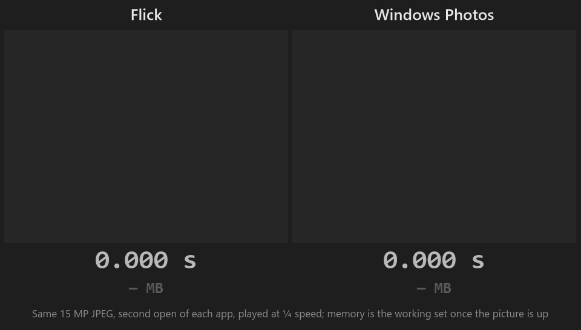
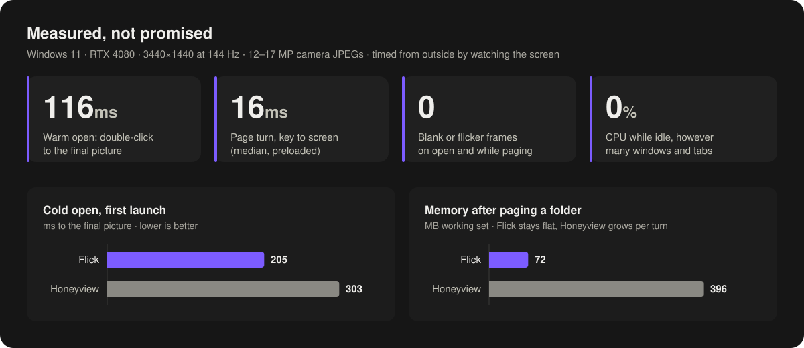
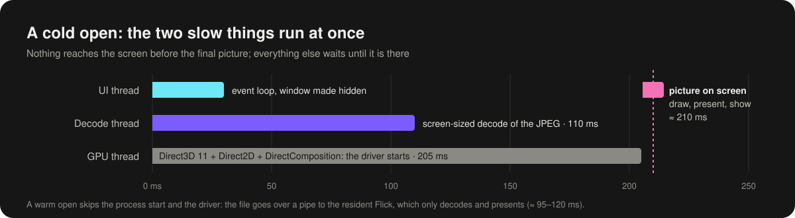

<p align="center">
  
</p>

<p align="center">
  
  
  
  
</p>

<p align="center">
  
</p>

Flick is an image viewer built around one idea: **the picture, and nothing
else.** On screen before you have finished double-clicking, and never more of
it in memory than the screen can show. It opens a 17-megapixel JPEG in about
a tenth of a second, pages through a folder of them as fast as you can press
a key, and keeps twenty tabs open in under 100 MB, where other viewers pass
400 MB in four page turns. There is no title bar and nothing else on screen
until you move the mouse: the window is the picture.

Honeyview set the bar for a quiet, fast Windows viewer, and IrfanView and
XnView are fine programs. Flick was written to beat them on the two numbers
that matter: how long you wait, and how much of your RAM it keeps.

Every number on this page is measured, per build, from outside the program,
by a tool that watches the screen.

## Philosophy

**Nothing before the picture that the picture doesn't need.** Opening a file
is a critical path. Folder listing, menus, fonts, metadata, the tray icon and
the update check all wait until the final picture has been presented. No
splash, no placeholder, no blurry thumbnail that gets swapped out: the first
frame you see is the real one.

**Memory is a feature.** The cache holds screen-sized pictures, about 17 MB
each for a 17 MP JPEG, five of them around the one you are looking at, shared
by every window and tab and trimmed on every page turn. Full resolution
exists only for the picture you are zoomed into. So paging through a thousand
photos costs the same as paging through five, twenty tabs fit in under
100 MB, and viewers that cache full-resolution decodes pass 400 MB in four
page turns. Idle windows cost 0 % CPU: no timers, no redraws.

**The screen is the unit of work.** A 45 MP photo on a 1440p monitor needs
about 4 MP of pixels, so that is what gets decoded, using the JPEG decoder's
own downscaling. Full resolution is decoded only when you zoom in past it,
and only for the picture you are looking at.

**One process, warm.** The first Flick stays resident in the tray with its
graphics device ready. Every later double-click hands its file over a pipe
and exits, so a typical open skips process start-up and the ~170 ms it
takes a GPU driver to wake up.

**Never a blank or frozen frame.** Paging keeps the current picture up until
the next one is ready; zooming shows the screen-sized picture until the
sharp one fades in over it. Decoding never happens on the UI thread.

<p align="center">
  
</p>

|                                   | Flick      | Honeyview |
|-----------------------------------|-----------:|----------:|
| Cold open, 17 MP JPEG             | 205 ms     | 303 ms    |
| Warm open, same file              | 116 ms     | –         |
| Page turn, median                 | 16 ms      | ~140 ms   |
| Working set after paging a folder | 72 MB      | 396 MB    |
| Blank or flicker frames; idle CPU | 0; 0 %     | –         |

## What it does

- **Frameless windows** that still move, resize and snap like any other;
  resizing pauses where the window takes the picture's shape. A
  hover bar and a tab strip fade in over the picture when the mouse needs
  them, then get out of the way. **Full screen** with F11 or Enter: black
  around the picture, the cursor hidden while still, Esc to leave.
- **Tabs**, many windows, Move to Window, and a close history: Ctrl+Shift+T
  brings back a closed tab or a whole window, and windows left open by a
  crash or a shutdown come back the same way.
- **Fast paging** with a preload ring around the current picture, random
  order, sibling folders with `[` and `]`, and a per-tab back/forward
  history. The folder is watched, so new and renamed files just appear.
- **Formats:** JPEG (with fast progressive decoding), PNG, APNG, GIF, WebP and
  animated WebP, JPEG XL, HEIC, AVIF, TIFF, BMP, ICO, SVG, OpenEXR and
  Radiance HDR, and camera RAW (CR2, CR3, NEF, ARW, DNG, ORF, RAF, RW2, PEF
  and more), shown instantly through the JPEG every camera embeds. RAW
  beyond the embedded preview, HEIC and AVIF use Microsoft's free *Raw
  Image*, *HEIF* and *AV1* extensions from the Store.
- **Zoom** to any level with the sharpest pixels decoded on demand; pictures
  too big for the GPU are tiled, up to ~268 MP at full resolution.
- **Colour managed:** wide-gamut photos (Display P3, Adobe RGB) are converted
  to sRGB instead of being shown oversaturated.
- **Stars:** one keystroke marks a favourite, without touching the file, and
  a starred folder can collect them as links or copies.
- **Keyboard first:** every key is listed in the right-click menu beside what
  it does. Slideshow, rotate and flip, copy to clipboard, show in Explorer,
  delete to the Recycle Bin.
- **Quiet updates:** a new version downloads in the background, is checked
  against a signing key built into Flick, and waits for you to relaunch.
- **Safe with bad files:** a damaged JPEG or PNG is shown as far as it
  reads; a file that can't be shown says why in its window, and you page on.
  A malformed or crafted file fails on its own: sizes are checked before
  anything is allocated, a decoder's crash stays with its file, and an SVG
  can't reach outside itself (details in ARCHITECTURE.md §7a).

## How it opens so fast

<p align="center">
  
</p>

The two slow parts of a first launch, decoding the file and starting the
graphics driver, begin at the first line of `main` on threads of their own.
The window is created hidden and placed at its final size, and shown only
after the first present of the final picture, with the Windows open
animation turned off. The resident process then makes every later open a
warm one. The details, with the measurements behind each decision, are in
[ARCHITECTURE.md](ARCHITECTURE.md).

The numbers are measured, not estimated. `flick-bench` launches a viewer and
times the moment the final picture appears on screen, with blank and flicker
frames counted. `bench/quick.ps1` runs it before every milestone against a
saved baseline, and flags any figure that got worse.

## What Flick is not

Flick stays fast by saying no to things. These are deliberate:

- **Not cross-platform.** Rendering (Direct2D, DirectComposition), decoding
  (Windows Imaging Component), the single-instance pipe and the shell
  integration are Windows APIs called directly. The caching and paging
  design would carry over to another system; every platform call would not.
- **Not for legacy Windows or hardware.** Windows 10 or 11, 64-bit only. It
  needs a GPU with a Direct3D 11 driver; there is no software-rendering
  fallback, no 32-bit build and no Windows 7 or 8 support.
- **Not an editor, organiser or catalogue.** No pixel editing, no thumbnail
  grid, no tags database, no printing, no plugins. Stars are the one piece of
  library it keeps, and it never writes to your images.
- **Not a colour-managed proofing tool.** Pictures are converted to sRGB;
  the display's own ICC profile is not applied.

## Install

Download `Flick-<version>-setup.exe` from
[Releases](https://github.com/Timsonrobl/Flick/releases). It installs for the
current user, without administrator rights, into
`%LOCALAPPDATA%\Programs\Flick`, and adds Flick to *Open with* and to
**Settings ▸ Apps ▸ Default apps**, where you can make it the default viewer.

The installer isn't code-signed, so Windows SmartScreen asks once whether
to run it. Updates are downloaded by Flick itself and don't ask again.

## Build from source

You need Rust (stable, MSVC toolchain) on Windows 10 or 11.

```powershell
.\tools\build.ps1 -p flick-app        # release build; works while Flick is running
cargo test --release -p flick-app     # unit tests
.\tools\install-local.ps1             # install this build over your installed Flick
.\tools\install-local.ps1 -Commit <hash>  # or a kept build of a recent commit
```

Between releases the version is the next one's pre-release (`1.1.0-dev`),
so a local build never passes for a release, and the release replaces it
as an update once it is out. `tools/` also has scripts to register a build
for *Open with*, run the benchmark and make the installer;
`bench/README.md` covers the benchmark method and every measurement so far.

## Licence

Flick is free software under the [GNU General Public License, version 3 or
later](LICENSE). The libraries it is built with are listed, with their
licences, in `THIRD-PARTY-NOTICES.txt`, which ships with every installer.
The benchmark photos are CC0 and public domain (`bench/images/CREDITS.md`);
the photo in the race above is
[*Rocky ride* by simon berger](https://commons.wikimedia.org/wiki/File:Rocky_ride._-_Flickr_-_simon_berger.jpg),
CC0, cropped.
